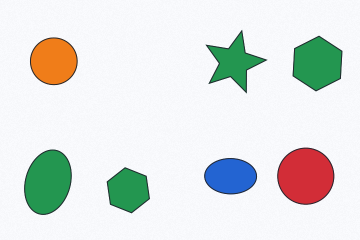
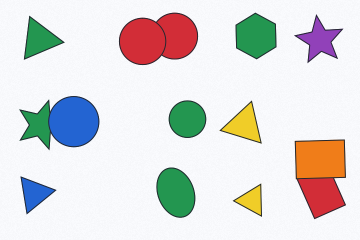
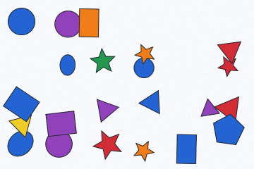

# NyanCaptcha

English | [简体中文](README.zh-CN.md)

A pure-Go spatial-reasoning CAPTCHA library. Random geometric scenes are paired with English or simplified-Chinese questions about shape, color, position, size, occlusion, and combinations of these properties.

Requires Go 1.24 or newer; supports Linux, macOS, and Windows.

## Examples

| Difficulty | CAPTCHA | Question | Answer |
| --- | --- | --- | --- |
| Easy |  | How many shapes are orange? | 1 |
| Medium |  | How many shapes (are red) and (have the shape of a circle)? | 2 |
| Hard |  | How many shapes ((have their centers in the bottom half of the image) and (are blue)) and (have their centers in the right half of the image)? | 3 |

## Install

```sh
go get github.com/mxmilu666/nyancaptcha
```

## Quick start

```go
package main

import (
    "fmt"
    "log"
    "os"

    nyancaptcha "github.com/mxmilu666/nyancaptcha"
)

func main() {
    generator, err := nyancaptcha.New(
        nyancaptcha.WithSize(360, 240),
        nyancaptcha.WithDifficulty(nyancaptcha.Hard),
        nyancaptcha.WithLanguage(nyancaptcha.Chinese),
    )
    if err != nil { log.Fatal(err) }
    challenge, err := generator.Generate()
    if err != nil { log.Fatal(err) }
    fmt.Println(challenge.Question)
    fmt.Println(challenge.Answer) // Server-side only; never send with the image.
    if err := os.WriteFile("captcha.png", challenge.Image, 0600); err != nil {
        log.Fatal(err)
    }
}
```

A `Generator` is immutable after construction and safe for concurrent calls. Every call owns its scene, expressions, and output bytes. Options copy slice inputs. `Challenge` exposes `Question`, decimal `Answer`, PNG `Image`, and evaluation metadata `Type` and `Difficulty`; it never exposes the scene or target IDs.

Generation uses bounded attempts. `errors.Is(err, nyancaptcha.ErrExhausted)` identifies incompatible or unlucky scene/question constraints; the wrapped error gives the final rejection reason. Increasing retries does not make an impossible configuration satisfiable.

## Configuration

| Option | Default | Constraints / meaning |
| --- | --- | --- |
| `WithSize(w, h)` | 360 × 240 | Width 240–1200, height 180–900, at most 720,000 pixels |
| `WithDifficulty(d)` | `Medium` | `Easy`, `Medium`, `Hard` |
| `WithLanguage(l)` | `English` | `English`, `Chinese` |
| `WithShapeCount(min, max)` | Difficulty-specific | Inclusive range, 5–30 |
| `WithShapes(kinds...)` | All seven | Nonempty unique `scene.Kind` values |
| `WithQuestionTypes(types...)` | All eight | Nonempty unique `question.Type` values; at least one must fit difficulty |
| `WithColors(colors...)` | Six colors | 1–12 opaque colors, unique nonempty bilingual names, RGB separation ≥80 |
| `WithMaxRetries(n)` | 80 | 1–1000 scene attempts |
| `WithBackground(color.RGBA)` | Light opaque background | Opaque; RGB distance ≥90 from fills |
| `WithTexture(enabled)` | Enabled | Subtle deterministic background texture |

Custom palette names are semantic declarations by the caller: the library cannot determine whether a name such as “blue” accurately describes an arbitrary RGB value. Color-distance checks are conservative heuristics, not perceptual or color-blind accessibility guarantees.

```go
// Add these imports to your program:
// "github.com/mxmilu666/nyancaptcha/question"
// "github.com/mxmilu666/nyancaptcha/scene"
g, err := nyancaptcha.New(
    nyancaptcha.WithDifficulty(nyancaptcha.Medium),
    nyancaptcha.WithShapes(scene.Circle, scene.Triangle, scene.Star),
    nyancaptcha.WithQuestionTypes(question.Spatial, question.ColorShape),
    nyancaptcha.WithShapeCount(10, 12),
)
```

## Difficulty and questions

| Difficulty | Default shapes | Atomic conditions | Layout |
| --- | --- | --- | --- |
| Easy | 5–8 | 1 | Sparse overlap |
| Medium | 9–14 | 2 | Spatial and attribute composition, moderate overlap |
| Hard | 15–22 | 3 | Multiple distractors, spatial/size/occlusion composition |

Condition complexity changes independently of shape count; overriding count does not change semantic depth. Layout overlap probabilities are 0.08, 0.22, and 0.38 respectively, subject to readability rejection. Scene and question rejection affects the final distribution: it is randomized but **not claimed to be uniform**.

| Question type | Reasoning |
| --- | --- |
| `question.Basic` | One shape or color attribute; Easy only |
| `question.Spatial` | Canvas half or a relation to a uniquely described target |
| `question.ColorShape` | Color and kind intersection; Medium/Hard |
| `question.Occlusion` | Actual shape occlusion / visibility |
| `question.Size` | Area comparison against a unique target |
| `question.Compound` | AND, OR, or neighborhood count comparison |
| `question.MultiTarget` | Relation to **all** matching targets, with multiple references required |
| `question.Exclusion` | Explicit negation and intersection |

Questions are executable predicate trees with language-specific grammatical rendering. Answers are calculated by evaluating the tree on each shape. Unique references use color and kind, not invisible IDs; universal references are explicitly quantified and nonempty. Self-reference is excluded. Every returned question has a positive answer below the total shape count, sufficient visibility, no relevant boundary ambiguity, and text and answer matching the expression. Some category/configuration combinations may not admit a valid question.

## License

MIT; see [LICENSE](LICENSE).
