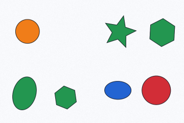
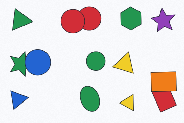
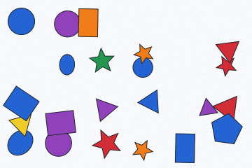

# NyanCaptcha

[English](README.md) | 简体中文

一个纯 Go 实现的空间推理图片验证码库。通过随机生成几何场景，提出关于形状、颜色、位置、大小、遮挡及其组合条件的英文或简体中文问题。

要求 Go 1.24 或更新版本，支持 Linux、macOS 和 Windows。

## 示例

| 难度 | 验证码图片 | 问题 | 答案 |
| --- | --- | --- | --- |
| Easy（简单） |  | 有多少个橙色图形？ | 1 |
| Medium（中等） |  | 有多少个红色圆形？ | 2 |
| Hard（困难） |  | 有多少个蓝色图形的中心同时位于图片的下半部分和右半部分？ | 3 |

## 安装

```sh
go get github.com/mxmilu666/nyancaptcha
```

## 快速开始

```go
package main

import (
    "fmt"
    "log"
    "os"

    nyancaptcha "github.com/mxmilu666/nyancaptcha"
)

func main() {
    generator, err := nyancaptcha.New(
        nyancaptcha.WithSize(360, 240),
        nyancaptcha.WithDifficulty(nyancaptcha.Hard),
        nyancaptcha.WithLanguage(nyancaptcha.Chinese),
    )
    if err != nil { log.Fatal(err) }
    challenge, err := generator.Generate()
    if err != nil { log.Fatal(err) }
    fmt.Println(challenge.Question)
    fmt.Println(challenge.Answer) // Server-side only; never send with the image.
    if err := os.WriteFile("captcha.png", challenge.Image, 0600); err != nil {
        log.Fatal(err)
    }
}
```

`Generator` 构造后配置不可变，可安全并发调用。每次生成都独立持有场景、表达式和输出字节；配置选项会复制传入的切片。`Challenge` 包含题目 `Question`、十进制字符串答案 `Answer`、PNG 字节 `Image`，以及用于评估的 `Type` 和 `Difficulty`，不会暴露场景或目标图形 ID。

生成尝试次数有明确上限。通过 `errors.Is(err, nyancaptcha.ErrExhausted)` 可判断是否因场景与题目约束不兼容，或多次尝试均未找到有效组合而失败；包装的错误包含最后一次拒绝原因。增加重试次数不能使不可能满足的配置变得可行。

## 配置选项

| 选项 | 默认值 | 约束与含义 |
| --- | --- | --- |
| `WithSize(w, h)` | 360 × 240 | 宽 240–1200，高 180–900，总像素不超过 720,000 |
| `WithDifficulty(d)` | `Medium` | `Easy`、`Medium`、`Hard` |
| `WithLanguage(l)` | `English` | `English`、`Chinese` |
| `WithShapeCount(min, max)` | 由难度决定 | 包含上下界，允许 5–30 个图形 |
| `WithShapes(kinds...)` | 全部 7 种 | 非空且不重复的 `scene.Kind` 列表 |
| `WithQuestionTypes(types...)` | 全部 8 类 | 非空且不重复的 `question.Type` 列表，至少一类适用于所选难度 |
| `WithColors(colors...)` | 6 种颜色 | 1–12 种不透明颜色；中英文名称非空且唯一；RGB 距离 ≥80 |
| `WithMaxRetries(n)` | 80 | 允许 1–1000 次场景生成尝试 |
| `WithBackground(color.RGBA)` | 浅色不透明背景 | 必须不透明，与填充色的 RGB 距离 ≥90 |
| `WithTexture(enabled)` | 启用 | 轻量、可复现的背景纹理 |

自定义颜色名称由调用方负责：库无法判断任意 RGB 值是否确实符合“蓝色”等名称。颜色距离检查只是保守的启发式规则，不等同于感知色差验证，也不保证色觉障碍用户的可访问性。

以下片段可加入已有程序，并补充相应导入：

```go
// Add these imports to your program:
// "github.com/mxmilu666/nyancaptcha/question"
// "github.com/mxmilu666/nyancaptcha/scene"
g, err := nyancaptcha.New(
    nyancaptcha.WithDifficulty(nyancaptcha.Medium),
    nyancaptcha.WithShapes(scene.Circle, scene.Triangle, scene.Star),
    nyancaptcha.WithQuestionTypes(question.Spatial, question.ColorShape),
    nyancaptcha.WithShapeCount(10, 12),
)
```

## 难度与题型

| 难度 | 默认图形数量 | 原子条件数量 | 布局与推理 |
| --- | --- | --- | --- |
| Easy | 5–8 | 1 | 少量重叠 |
| Medium | 9–14 | 2 | 空间关系与属性组合，中等重叠 |
| Hard | 15–22 | 3 | 多个干扰对象，位置、大小与遮挡组合 |

条件复杂度与图形数量独立变化；覆盖图形数量不会改变推理深度。三档布局尝试产生重叠的概率分别为 0.08、0.22、0.38，不满足可读性要求的场景仍会被拒绝。场景和题目的拒绝筛选会影响最终分布：生成过程随机，但**不保证均匀分布**。

| 题型 | 推理内容 |
| --- | --- |
| `question.Basic` | 单一形状或颜色属性，仅适用于 Easy |
| `question.Spatial` | 画面半区，或相对于唯一描述目标的空间关系 |
| `question.ColorShape` | 颜色与形状的交集，适用于 Medium/Hard |
| `question.Occlusion` | 基于实际形状的遮挡与可见性 |
| `question.Size` | 与唯一目标进行面积比较 |
| `question.Compound` | AND、OR 或关系邻域内的数量比较 |
| `question.MultiTarget` | 相对于**所有**匹配目标的关系，要求存在多个参考目标 |
| `question.Exclusion` | 显式排除与条件交集 |

题目以可执行的谓词树表示，再按照语言语法生成文本。答案通过逐个图形求值获得。唯一目标由颜色和形状描述，不依赖不可见的 ID；全称量化会明确表达“所有”，且目标集合不能为空。图形不与自身建立目标关系。返回的题目答案大于零且小于图形总数，图形足够可见，相关关系不存在边界歧义，文本与答案均与表达式一致。部分题型与配置组合可能无法生成有效题目。

## 许可证

MIT，详见 [LICENSE](LICENSE)。
